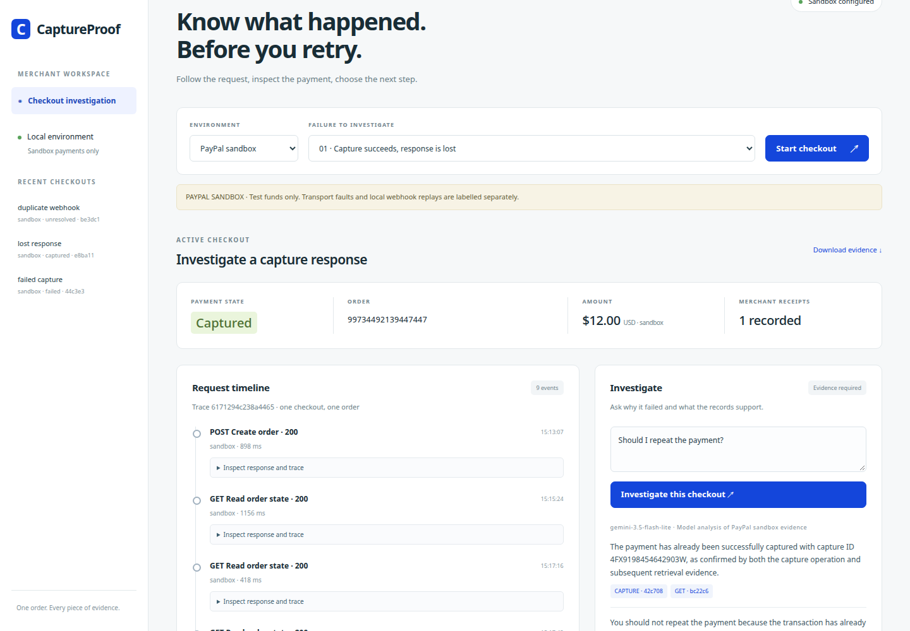

# CaptureProof

A small merchant checkout that joins payment requests to order and capture evidence. A failed request can leave a successful payment behind. CaptureProof shows the difference before a merchant tries again.

Verified against PayPal sandbox on November 5, 2026: all three cases completed with one capture and one merchant receipt each. The rejected request returned `422 ORDER_NOT_APPROVED`, then recovered on the same order after guest buyer approval and an explicit recovery action. [Saved responses and verification](docs/sandbox-evidence/verification.json) include the separately labelled injected transport fault and local delivery replay.



## Run in five minutes

Use Node.js 24 or newer. There are no packages to install, containers, databases to provision, or hosted services.

```sh
git clone https://github.com/adityareddy-dev/captureproof.git
cd captureproof
npm start
```

Open **http://localhost:4317**. Leave the environment on **Synthetic rehearsal**, choose a fixture, and click **Start checkout**. Rehearsal needs no credentials or network access. It uses local synthetic payment responses, with that label shown throughout the timeline. Without model access, the investigation panel shows the deterministic transaction checks and says the model is unavailable.

```sh
npm test
```

Tests cover the three cases, recovery response loss across restart, conflicting and missing evidence, simultaneous capture clicks, redaction, rejected model output, webhook verification and the local HTTP boundary.

## The three fixtures

| Fixture | Steps after Start checkout | Expected payment evidence | Merchant result |
| --- | --- | --- | --- |
| Capture succeeds, response is lost | Simulate buyer approval, capture, reconcile | COMPLETED capture and a separately labelled injected response loss | No second capture. Reconcile records one receipt. |
| The same webhook arrives twice | Simulate buyer approval, capture, replay the delivery twice | One COMPLETED capture plus local delivery replay records | Duplicate delivery is ignored. One receipt. |
| Capture rejected before buyer approval | Try capture before approval, simulate buyer approval, recover | Initial HTTP 422 ORDER_NOT_APPROVED, then an explicitly requested COMPLETED capture | No receipt for the rejection. One receipt after recovery. |

The failed-capture case demonstrates a rejected capture request before buyer approval. It does not claim a declined card or a funding failure. A pending capture, a timeout without capture evidence, conflicting capture states, an unexpected amount, or a mismatched order remains **Unresolved**. The console never treats a missing response as proof of failure.

The local webhook replay is a delivery test built from the capture record, not a webhook received from PayPal. Actual webhook delivery requires an externally reachable URL and signature verification. The local demo does not require that URL.

## PayPal sandbox

Create a free sandbox REST app in the [PayPal developer dashboard](https://developer.paypal.com/dashboard/applications/sandbox). Have a sandbox buyer account ready to approve the test order. Guest checkout also works with a card from the [sandbox card generator](https://developer.paypal.com/sandbox-testing/card-testing). Use generated cards, test buyer details and test funds only. If a published static card is rejected, generate a new sandbox card. Guest checkout may appear under **Pay with Debit or Credit Card** or **Create an Account**. Turn off **Save info & create your PayPal account** to complete approval as a guest. Store configuration in a private file outside this checkout, for example `/home/paperclip/.hackathons/env`, with file permissions `600`:

```text
PAYPAL_CLIENT_ID=<sandbox app client ID>
PAYPAL_CLIENT_SECRET=<sandbox app secret>
GEMINI_API_KEY=<key from a project on the free tier>
GEMINI_FREE_TIER_CONFIRMED=yes
```

The default credential path is `/home/paperclip/.hackathons/env`. To use another private file:

```sh
CAPTUREPROOF_ENV=/absolute/private/path npm start
```

Verify access with `npm run access`. It prints only status codes and model names. It does not print credentials. Missing sandbox access produces a nonzero exit code even when the model works.

For this build, the private credential file is `/home/paperclip/.config/captureproof/env`. Start with `CAPTUREPROOF_ENV=/home/paperclip/.config/captureproof/env npm start` to use it.

Restart the app after changing configuration. Select **PayPal sandbox** before creating a checkout. For the two successful-capture cases, open the buyer approval link, approve with a **sandbox buyer**, return to the console, and explicitly capture. For the rejected-capture case, first try capture before approval. Inspect the actual rejection, open buyer approval for the same order, return, and click recovery. Each capture requests a fresh order lookup first. A return URL alone is never treated as proof of approval.

Every payment request uses `https://api-m.sandbox.paypal.com`. There is no production endpoint setting and no negative-test header. The amount is fixed at USD 12.00 in test funds. The request trace retains the HTTP status, redacted response, PayPal debug ID when supplied, request ID, timestamps and duration. Response hashes cover retained fields, not the unredacted response.

Optional real webhook verification uses `PAYPAL_WEBHOOK_ID` and `POST /api/webhook`. Supply PayPal's transmission headers with the unmodified webhook body. An event must match a known sandbox checkout, pass PayPal signature verification, and reconcile against the order before it can create a receipt. A local replay cannot enter that verification path.

## Investigation model

The default model is `gemini-3.5-flash-lite`, used through the Gemini REST API on an observed free-tier project. `GEMINI_MODEL` can select another compatible Gemini model. Set `GEMINI_FREE_TIER_CONFIRMED=yes` only after checking the project's billing tier. No paid fallback is configured. Rehearsal payment evidence can be sent to the model, but that analysis remains labelled as rehearsal.

The model receives redacted evidence facts and the merchant's question. It explains the relationship between a capture, the request failure and repeated delivery, and cites evidence IDs. Fixture names are excluded from its input so the model cannot use a scenario title as evidence that a failure occurred. It has no payment tools. The server validates its state, citations and proposed next step. Findings that claim a completed payment need a matching completed-capture response among their own citations. Model prose cannot supply capture instructions. The console displays the payment state and next action from the transaction checks, and omits the separate free-text answer. A rejected or unavailable explanation falls back to the transaction checks with a visible notice. These checks constrain the response but do not prove every sentence of free text, so the linked evidence remains available for inspection.

Run the known-case model evaluation with free access configured:

```sh
node scripts/evaluate-model.mjs
```

[The saved evaluation](docs/model-evaluation.json) contains actual model responses to synthetic evidence, including missing and conflicting evidence. It is not a sandbox payment record. No model output can invoke the capture endpoint.

## Recovery and persistence

Before a capture, the server checks the order ID, checkout reference, amount, currency, approval state and absence of captures. It writes the capture request ID and a sent marker to SQLite before making the network request. Repeated clicks are locked while an action runs. A crash or uncertain response leaves the marker set and blocks another capture after restart. Reconciliation is read-only at PayPal.

An explicit recovery is allowed only after the known ORDER_NOT_APPROVED rejection, a fresh APPROVED order with no captures, and a separate merchant click. It receives a new request ID because it follows a definitive rejection. If recovery loses its response, its unanswered attempt takes precedence over the earlier rejection. The displayed outcome stays unresolved after restart, and another capture stays blocked. A matching completed capture from reconciliation resolves the outcome and records one receipt. Unknown failures are not automatically retried. Receipts have a database uniqueness constraint per checkout. Run one application process per database. This is a local demonstration, with a simulated merchant receipt rather than external fulfilment.

State is stored in `data/captureproof.sqlite`, which is excluded from Git. Stop the app and remove `data/` to start clean, or select another path with `CAPTUREPROOF_DB`. Do not remove state while investigating an uncertain sandbox capture. The app binds to loopback. Capture routes require same-origin JSON requests and a local request header. Keep the console local.

## Evidence and demonstration

[Recovery and investigation regressions](docs/review-fixes.md) include restart screenshots, browser results, and fresh read-only sandbox checks.

Each investigation finding links to its matching response or trace event. Use **Download evidence** to save a redacted checkout bundle. A gateway response withheld by the transport fixture is explicitly marked as not delivered to the checkout. The injected fault has its own provenance label. Local webhook replay has a different label from verified PayPal delivery.

[The demo script](docs/demo-script.md) describes the recorded sandbox demonstration, with [exact timed captions](docs/demo-captions.vtt). [The submission text](docs/entry-draft.md) is ready for review. Public repository and YouTube publication follow that review. [The technical notes](docs/design.md) map the implementation to the judging criteria.

After completing all three fixtures in sandbox, reconcile and investigate the lost-response case, then export and check the latest sandbox run of each fixture:

```sh
node scripts/verify-sandbox.mjs
```

This reads the running local application and sends no payment requests. It requires one completed capture and one receipt per case, the real pre-approval rejection followed by explicit recovery, separately labelled fault and delivery replay, and a current model investigation with evidence citations. Synthetic rehearsal cannot satisfy it. On success it writes redacted bundles and a verification report under `docs/private/sandbox-evidence/`, excluded from Git until the evidence is reviewed. The [reviewed sandbox evidence](docs/sandbox-evidence/verification.json) is included for inspection. The earlier [rejection checkpoint](docs/sandbox-evidence/failed-before-recovery.json) has zero receipts before recovery.

MIT licensed.
