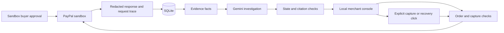

# Design and judging criteria

The audience is a small merchant who sees a failed checkout request and needs to decide whether the buyer has already paid. The demonstrated benefit is a payment decision tied to its evidence. No sales, latency improvement or superiority measurement is claimed.

| Criterion | What the build demonstrates | Evidence still needed |
| --- | --- | --- |
| Technological implementation | Orders and capture API adapter, correlated traces, persistent capture guards, receipt deduplication, model explanations with evidence citations | Three real sandbox runs and their exported responses |
| Design | Checkout, trace timeline, investigation, evidence inspection and explicit actions in one local console | Cold review with sandbox access |
| Potential impact | A specific merchant decision: whether another capture could repeat a completed payment | User impact beyond the demonstration has not been measured |
| Innovation | Payment-state evidence and read-only investigation alongside a constrained recovery path | No claim of novelty over all other tools |
| Presentation | Lost response, evidence inspection, failed request and recovery, with duplicate delivery shown briefly | Final sandbox recording under three minutes |

The [published rubric](https://paypalaihackathon.devpost.com/rules) gives these five criteria equal weight. The PayPal integration is central: order and capture state determines the merchant decision. The model's contribution is an explanation of several records together, tailored to a merchant question. Payment state and actions stay in ordinary server code.

## Data flow

## Boundaries

The console records its own traces, not a fleet-wide OpenTelemetry collector. Every event carries the checkout trace ID and order ID. The response body is an allowlisted subset. Personal buyer fields and access tokens are omitted. Timings are local request durations, with no claim about production PayPal performance.

The lost response is injected after the gateway receives a successful capture response. The gateway preserves that response as evidence, marks it as withheld from the checkout, and leaves the merchant receipt unrecorded until reconciliation. The application does not claim an actual PayPal outage.

The failed request makes an ordinary capture call on an unapproved order, without a mock header. That sandbox path remains unverified until credentials are available. If PayPal returns a different error, the app does not relabel it as ORDER_NOT_APPROVED. It keeps the uncertain capture marker and blocks recovery.

One receipt row per checkout provides local deduplication. It is not a guarantee for an external shipping provider. A real merchant would use an outbox and the fulfilment provider's idempotency mechanism. Multi-process operation is outside this local build.

## Source references

- [Orders API](https://developer.paypal.com/api/orders/v2)
- [Capture approval and request IDs](https://developer.paypal.com/api/orders/v2/orders-capture)
- [Sandbox negative testing](https://developer.paypal.com/negative-testing/request-headers), consulted to distinguish mocked responses from ordinary API failures
- [Gemini structured output](https://ai.google.dev/gemini-api/docs/structured-output)
- [Gemini pricing](https://ai.google.dev/gemini-api/docs/pricing)
